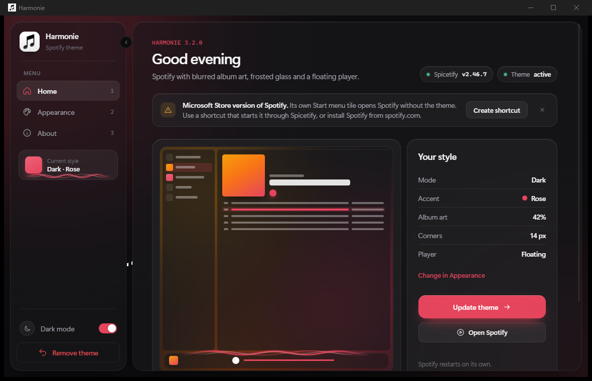
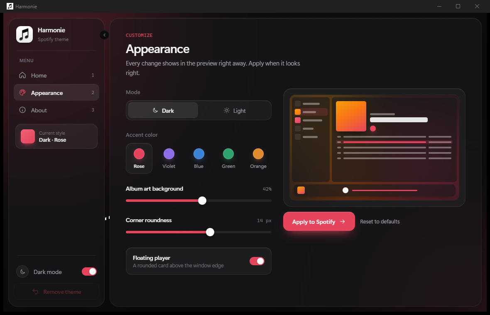
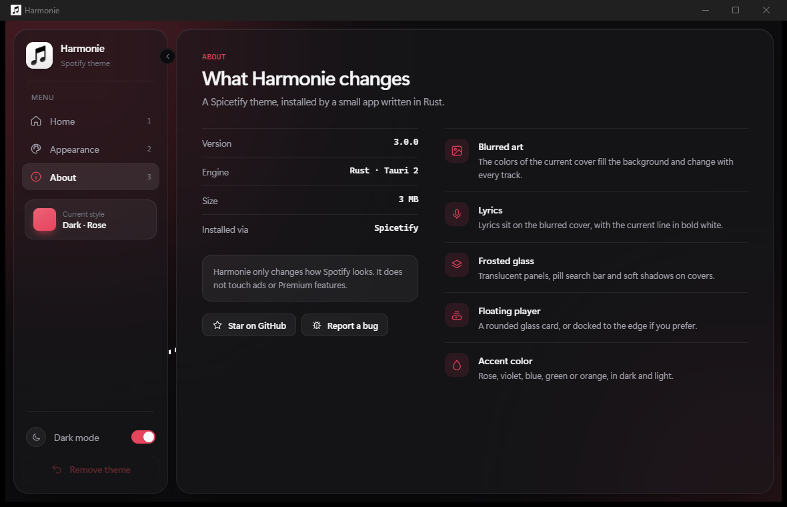

<p align="center"></p>

<h1 align="center">Harmonie</h1>

<p align="center">
  A clean, Apple Music-inspired theme for Spotify.<br>
  Install it in one click with a tiny Rust app, or straight from the Spicetify Marketplace.
</p>

<p align="center">
  <a href="https://github.com/Kehazy/harmonie/releases/latest"></a>
  <a href="https://github.com/Kehazy/harmonie/releases"></a>
  <a href="https://github.com/Kehazy/harmonie/stargazers"></a>
  <a href="LICENSE"></a>
  <a href="https://spicetify.app"></a>
</p>

<p align="center"></p>

---

## Features

- **Blurred album art** — the colors of the current cover fill the window and change with every track
- **Frosted glass** — translucent panels and rounded corners everywhere
- **Floating player** — the bottom player becomes a rounded glass card
- **5 accent colors** — rose, violet, blue, green, orange
- **Dark and light** — 10 color schemes in total
- **One-click install and undo** — the app restores the theme you had before
- **Tiny and fast** — the installer is a 3 MB native Rust app, no Electron

Harmonie only changes how Spotify looks. It does not touch ads or Premium features.

## Install

### Option 1: the Harmonie app (Windows)

1. Install [Spicetify](https://spicetify.app) if you don't have it yet.
2. Download **[Harmonie.exe](https://github.com/Kehazy/harmonie/releases/latest)** and run it. No setup needed.
3. Pick a mode and a color in **Appearance**, then click **Apply to Spotify**.

> Windows SmartScreen may warn about an unknown publisher because the app is not code-signed yet. Click **More info**, then **Run anyway**.

### Option 2: Spicetify Marketplace (Windows, macOS, Linux)

Open the **Marketplace** tab in Spotify, go to **Themes**, search for **Harmonie** and click **Install**.

### Option 3: by hand

Copy the `theme/` folder to your Spicetify `Themes` folder as `Harmonie` (run `spicetify path userdata` to find it), then:

```
spicetify config current_theme Harmonie color_scheme dark inject_theme_js 1
spicetify apply
```

Available schemes: `dark`, `light`, `dark-violet`, `light-violet`, `dark-blue`, `light-blue`, `dark-green`, `light-green`, `dark-orange`, `light-orange`.

## Screenshots

| Appearance | About |
| --- | --- |
|  |  |

## Troubleshooting

**The theme does not show after a Spotify update.** Spotify updates replace Spicetify's changes. Open Harmonie and click **Update theme**: v2 refreshes the Spicetify backup automatically. By hand: `spicetify restore backup apply`.

**I use Spotify from the Microsoft Store.** Its own Start menu tile opens Spotify without the theme. In Harmonie, click **Create shortcut**: it puts a "Spotify (Harmonie)" shortcut on your desktop that starts Spotify through `spicetify auto`. Spicetify works best with the version from [spotify.com](https://www.spotify.com/download).

**I want my old look back.** Click **Remove theme** in the app. By hand: `spicetify config current_theme marketplace` then `spicetify apply`.

## Build from source

You need [Rust](https://rustup.rs) and the Visual Studio Build Tools ("Desktop development with C++").

```
cargo build --release
```

The app is written to `target/release/harmonie.exe`. If linking fails with `LNK1104`, the folder path is too long: set `CARGO_TARGET_DIR` to a short folder such as `C:\build\harmonie`.

| Path | What it is |
| --- | --- |
| `theme/` | The Spicetify theme: `color.ini`, `user.css`, `theme.js` |
| `src/main.rs` | Rust backend: finds Spicetify, writes the theme, runs `spicetify apply` |
| `ui/index.html` | The app's interface |
| `manifest.json` | Spicetify Marketplace listing |

## Contributing

Bug reports, screenshots and ideas are welcome in [Issues](https://github.com/Kehazy/harmonie/issues). Spotify changes its class names often; if something looks off after an update, a screenshot plus your Spotify version helps fix it fast.

If you like Harmonie, starring the repo helps other people find it.

## License

[MIT](LICENSE). Harmonie is an independent project, not affiliated with Spotify or Apple.
